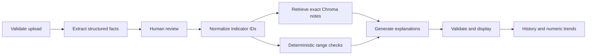

# Medical Report Interpreter

A local-first AI portfolio project for exploring laboratory reports with transparent
retrieval, structured validation and explicit uncertainty.

Upload a de-identified PDF or image, review extracted facts, and inspect the report's
values alongside retrieved knowledge provenance and gated explanations. The 26 inherited
notes are currently **Unverified**, so live medical explanations are withheld; extraction,
review, facts, history and numeric trends remain available. Or launch
the built-in **Synthetic demo** immediately: no API key, patient documents or embedding
model download required.

> Educational and technical demonstration only. Not a diagnostic, treatment or urgency
> triage tool. No clinical validation, accuracy benchmark or production deployment is claimed.

## What you can explore

- **Dashboard** — indicator counts, printed-range exceptions, uncertainty and knowledge coverage.
- **Upload & Analyze** — content validation, structured extraction, a mandatory review step,
  indicator-driven retrieval and checked explanations.
- **Detailed Results** — original facts, deterministic range checks, actual retrieved notes
  and generated explanations displayed separately.
- **History** — session history by default; explicit local SQLite saves when enabled,
  individual deletion and separate synthetic/live workspaces.
- **Trends** — dated numeric observations matched by stable indicator IDs, compatible unit
  conversion, transparent exclusions and no automatic disease-improvement claims.

The English UI uses native Streamlit components. Bilingual aliases recognize common
Chinese/English names and abbreviations. Unknown indicators stay visibly uncovered.

## Quick start

Requires Python **3.10–3.12**. Validation in this workspace used Python 3.10.11 on Windows;
other Python/platform combinations have not been tested here.

```bash
python -m venv .venv
# Windows PowerShell:
.\.venv\Scripts\Activate.ps1
# macOS / Linux:
# source .venv/bin/activate
python -m pip install -r requirements.txt
python -m streamlit run app.py
```

Open [http://127.0.0.1:8501](http://127.0.0.1:8501). The application defaults to
**Synthetic demo**. If PowerShell blocks activation, run
` .\.venv\Scripts\python -m streamlit run app.py ` directly.

The initial Chroma index contains only the existing 26 text notes. No sentence-transformer
or external embedding download is needed. Internet access is required to install dependencies;
after installation, the synthetic workflow does not make Claude API calls.

### A two-minute demo

1. On **Dashboard**, inspect the latest synthetic report: six indicators, one outside its
   printed synthetic range, two unclassified and four with project-note coverage.
2. Open **Detailed Results**, expand an indicator and compare original values, local
   evidence and the clearly labeled preset explanation.
3. Select the March report to see both high and low range checks.
4. Open **Trends** and select HGB. The three observations normalize to 134, 128 and 131 g/L;
   one source report is already in g/L and the others use g/dL.
5. In **History**, hide and restore synthetic reports. This changes only the current session.

All example values, dates and reference ranges are fabricated. Explanations in Demo Mode
are **preset examples, not live model output**. Synthetic data never enters the live SQLite store.

## Enable live Claude analysis

Copy `.env.example` to `.env` and configure:

```dotenv
ANTHROPIC_API_KEY=your-key-here
ANTHROPIC_MODEL=claude-sonnet-4-6
MRI_ENABLE_LOCAL_HISTORY=false
```

Use a model accessible to your Anthropic account with image/PDF and client-tool support.
The model is configurable; availability and quota are account-dependent. Restart the app
after changing configuration.

Switch to **Live analysis**. Remove identifying information from the report, accept the
document-transmission notice, extract the facts and compare them with the original.
Only then request explanations for eligible rows. With the shipped unverified corpus,
no rows qualify for live medical explanation; this is an intentional abstention, not an
API error. The workflow makes **at most two model requests**;
the SDK may retry a failed request once. API charges apply. Tests use mocks.

Uploaded content goes to Anthropic. Metadata stripping does not redact visible identifiers,
and prompts are not a guaranteed de-identification system. Do not upload real patient
documents to a public portfolio demonstration.

### Optional local history

Set `MRI_ENABLE_LOCAL_HISTORY=true` only on a trusted single-user machine. Results remain
session-only until **Save locally** is clicked in History.

- Default location: `.local_data/history.sqlite3`.
- Optional `MRI_DATA_DIR`: an absolute writable directory for SQLite and Chroma.
- Structured records include original extraction snapshots, corrections and any matched
  row excerpts. Raw uploads and original filenames are not saved.
- Structured records can still contain sensitive information. SQLite is not encrypted.
- Do not enable local history on shared/public servers: it is a shared server-side store,
  not a multi-user access-control system.
- Delete removes a record from the active history; it cannot erase backups or external copies.

The old `history/` and `chroma_db/` folders are preserved and never auto-imported.
Their records do not satisfy the new validation/provenance contract.

## Architecture



| Layer | Implementation |
| --- | --- |
| UI | Streamlit and native tables/charts |
| Data contracts | Pydantic v2, strict types and forbidden extra fields |
| Model access | Anthropic SDK, schema-bearing client-tool responses |
| Retrieval | ChromaDB keyed by normalized indicator ID |
| Checks | Local numeric/range parsing, conflict and uncertainty handling |
| Storage | Streamlit session state; optional local SQLite |
| Tests | pytest, mocked Claude calls, real local Chroma, Streamlit AppTest |

### Why exact retrieval instead of generic vector search?

The prototype retrieved 15 arbitrary relevant-looking notes using a fixed general query.
This version first identifies the actual report indicators, resolves known aliases, and
retrieves only their corresponding notes. With 26 short, structured documents, exact entity
retrieval is small, predictable and auditable.

Chroma remains the document store. Retrieval uses `get(ids=[...])`, not semantic similarity.
Constant one-dimensional placeholder vectors satisfy its storage interface; they are not
semantic embeddings. Current notes are re-indexed at startup and stale entries removed
from the dedicated v3 collection. Older collections are left untouched. Unknown indicators produce an explicit coverage gap.
See [knowledge provenance and unit policy](docs/KNOWLEDGE_BASE.md).

### Facts are not model opinions

Raw values and printed ranges are preserved. The application computes range status from
those strings, never from a model's asserted diagnosis or urgency. A result can be
`within_range`, `high`, `low`, `unknown` or `conflict`.

Qualified values such as `<5`, text results, missing ranges, ambiguous units or uncertain
extraction remain unclassified. Printed flags conflicting with calculated ranges require
manual review. No hard-coded medical critical-value rules or fixed visit timelines are shipped.

Each accepted explanation must cover an eligible row exactly once and cite only the note actually
retrieved for that row. The knowledge notes inherited from the MVP have no verified
bibliography and are prominently labeled **unverified project notes**, not medical authority.
Schema validation cannot verify the medical accuracy of free-form explanations.

## Uncertainty & Abstention

The interpretation gate is deterministic application code, not a prompt-only instruction
or an LLM confidence percentage. `interpreter/abstention.py` reuses normalized IDs,
parsed numbers, printed-range checks, compatible-unit definitions and retrieved notes.

| Readiness | Meaning | Typical next action |
| --- | --- | --- |
| `interpretable` | Current checks permit a bounded educational explanation | Check the report and remember that clinical applicability is not established |
| `needs_review` | Ambiguity or conflicting data prevents interpretation | Resolve the stated value, unit, interval, name or correction conflict |
| `insufficient_evidence` | Required data or usable supporting content is missing | Obtain the missing value/unit/printed interval or review the unusable note |
| `unsupported` | Indicator, unit or knowledge coverage is outside current capabilities | Keep report facts visible and seek appropriate interpretation elsewhere |

Every decision contains stable reason codes, plain-language explanations and next actions.
These states are **not risk grades**: interpretable does not mean normal, and unsupported
does not mean dangerous. Multiple causes are retained; primary-state precedence is
needs_review → unsupported → insufficient_evidence, solely for consistent counts.

### Rules and actual data flow

- Unreadable extraction, missing/qualified/non-numeric values, ambiguous names, repeated
  analytes and conflicting printed flags block interpretation. An extreme value alone
  is never labeled an OCR error. Two agreeing model calls are not verification.
- Units must exist, be allowlisted and have a dimension appropriate to the indicator.
  Reference and measurement units must be reconciled. The range gate deliberately does
  not silently convert reference intervals, even when a compatible numeric conversion exists.
- Missing, reversed or ambiguous printed intervals block range-dependent explanations.
  Explicit demographic/method/laboratory context requirements must be confirmed. A generic
  printed interval is used only for a bounded comparison, not proof of population applicability.
- Missing knowledge blocks generated explanation. Mismatched IDs/hashes, empty/short notes
  or mismatched note headers fail the basic relevance gate. This is **not** semantic evidence
  evaluation or verification of medical content; inherited notes remain unverified.
- Derived facts inconsistent with retained extraction/corrections are recomputed and the
  affected row is withheld. Stale or duplicate corrections are not applied.
- Only eligible rows enter the second Claude call. If none qualify, no explanation call
  occurs. A missing, duplicated or incorrectly cited generated row is withheld while
  other valid eligible explanations survive. A globally malformed API response still
  withholds all generated explanations, but preserves report facts and decisions.
- Dashboard counts are computed locally. Refused rows never contribute to the eligible
  out-of-range count. Model-generated report summaries/limitations are not forwarded.
  Arbitrary free-text questions are currently unsupported and not sent, preventing them
  from bypassing the row gate by reintroducing refused data.

### Correct and revalidate

In **Upload & Analyze**, expand **Correct extracted fields**, select a row, edit the name,
value, unit, printed interval/flag or uncertainty/context fields, and provide a correction
reason. Explicitly confirm changed fields against the original report. **Apply correction
and revalidate** reruns normalization, range checks, retrieval and the interpretation gate.
The overall review checkbox is reset after edits.

Original extraction is retained separately from before/after corrections. Unconfirmed
changes remain blocked; confirmed changes still fail if information is missing or conflicting.
Corrections are human assertions, not independently verified medical facts. This version
does not reconcile multiple specimens/methods for repeated analytes; those stay under review.

The existing five pages, Synthetic Demo, local history and trends are preserved. Trends may
show reliable numeric observations even when interpretation lacks a reference interval or
knowledge note; this does not restore medical interpretability. Unconfirmed/conflicting
corrections and incompatible indicator units are excluded from trends.

### History compatibility

New records use schema v4. Existing v2/v3 records are upgraded **in memory**, with readiness
recomputed and old un-gated explanations withheld. Files are not rewritten automatically.
Existing fact-integrity checks still apply; genuinely malformed records are skipped with
a UI warning. Unsupported legacy JSON from the original MVP is not auto-imported.

This iteration adds evidence links and knowledge provenance, not Claim Audit or
multi-model cross-validation. It cannot detect every plausible OCR mistake or establish
that free-form medical language is true. No clinical evaluation is claimed.

## Evidence Tracking & Knowledge Provenance

Each extracted occurrence has a stable internal UUID derived from its extraction ID and
row position, independent of the analyte's canonical ID. Two WBC rows remain distinct.
Original name/value/unit/reference snapshots live in `ExtractedReport.sources`; corrections
are stored separately. Normalized rows and trend points carry the same observation ID.
Re-uploading a document creates a new extraction, not a deduplication match.

**Report source checks:** Claude returns facts only, never trusted IDs or locations.
For PDFs, local text extraction records a page and extracted-text line only when a unique
complete line exactly matches the extracted name, value, unit and range in order. No
neighboring document text is retained. This conservative check is a **text-layer match**,
not verification that OCR, table semantics or medical interpretation is correct. Scanned
images, multiline/ambiguous rows and unmatched text show **Unknown / source unverified**.
No bounding boxes or page guesses are fabricated. Human correction does not rewrite or
verify the original source. Synthetic examples explicitly have no real source document.

**Knowledge provenance:** all 26 legacy notes were inventoried in
`knowledge_base/provenance.json`, including content concerns and unconfirmed applicability.
Each retrieved snapshot includes stable `kb:<code>` ID, content-addressed revision
(`sha256:<digest>`), source list, applicability, review status, reviewer/date and audit note.
The inventory identifies unsupported assertions; it is **not a clinical review**. Original
text files remain unchanged. No source URL, author, publication date or reviewer was invented.
References to an organization inside a note are not a verified bibliography.

All shipped entries have **Unverified** status, empty external sources and unknown review
details. They are retrieved for inspection but cannot support live model explanations.
Synthetic Demo preserves its fixed examples through a preset-only path; passing these rows
to the live pipeline or Claude gateway does not bypass the source gate. The data contract
can represent reviewed, scoped sources, but this release's legacy loader does not promote
entries to reviewed status. Adding a real reviewed corpus requires a separate curation step.

Open **Detailed Results** → an indicator to see the retained extraction, current corrected
fields, observation ID, source check/location, knowledge ID/version and source metadata.
The UI distinguishes a retrieved-only note from an explanation's linked context. Legacy
note text is hidden behind an explicit opt-in because it may contain unsupported advice.
Retrieval, hashes and citation linkage do not prove that any generated medical claim is true.

V2/v3 histories receive deterministic occurrence IDs on load, unknown source locations and
recomputed readiness; old explanations are withheld. Nothing is rewritten automatically.
Snapshots retain their historical knowledge revision even if current note content changes.
These are local integrity checks, not signed audit logs or a tamper-proof evidence system.

## Continuing development across sessions

Read [AGENTS.md](AGENTS.md) and then [PROGRESS.md](PROGRESS.md), inspect `git status` and the
actual code, and run relevant tests. PROGRESS.md records completed stages, decisions,
failed checks, pending work and exact next steps. Stable checkpoints are committed locally;
no automatic push or remote repository creation is performed.

## Project layout

```text
app.py                         Streamlit launch entry
interpreter/
  models.py                    Strict raw/checked/generated contracts
  catalog.py                   Bilingual aliases and stable IDs
  validation.py                Numeric, range, conflict and citation checks
  abstention.py                Per-row readiness, actionable reasons and safe counts
  review.py                    Immutable extraction and correction reconciliation
  tracking.py                  Conservative PDF text matches and original source snapshots
  units.py                     Conservative conversion allowlist
  security.py                  Bounded image/PDF validation
  llm.py                       Claude extraction and explanation calls
  knowledge.py                 Chroma note indexing and retrieval
  pipeline.py                  Prepare / generate / validate orchestration
  storage.py                   Transactional SQLite history
  trends.py                    Series matching and exclusions
  demo.py                      Synthetic reports and preset explanations
  ui.py                        Five native Streamlit views
knowledge_base/                26 inherited notes and per-entry provenance inventory
tests/                         Core, security, storage, RAG, mock and UI tests
docs/                          Architecture, provenance, security and verification
.env.example                   Safe configuration template
```

The original root modules remain as re-exports; the old Python function signatures are
not maintained. See [architecture details](docs/ARCHITECTURE.md).

## Tests and verification

```bash
python -m pip install -r requirements-dev.txt
python -m pytest -q
python -m pip check
```

Tests exercise aliases, numeric/range boundaries, schema failures, source-reference
validation, real Chroma retrieval/update, unit conversions, history persistence/deletion,
trend exclusions, malformed/active files, mocked Claude responses and Streamlit page flows.
There are no paid model calls in the test suite.

See [the actual verification record](docs/VERIFICATION.md) for environment versions,
test results, service startup checks and remaining limitations.

### Screenshots

No screenshot is included in this revision. The app started successfully and its pages
passed automated Streamlit interaction tests, but desktop browser capture was stopped by
the automation tool because it could not reliably determine the current browser URL.
No mockup is presented as a runtime screenshot.

To add portfolio screenshots, run Synthetic demo and capture Dashboard, Detailed Results
and Trends. Save only reviewed, synthetic-only PNGs under `docs/screenshots/`.
Never include live reports, keys, usernames or other browser tabs.

## What changed from the MVP?

| Original prototype | This refactor |
| --- | --- |
| One-step model interpretation with generic-query RAG | Extraction → review → normalization → exact retrieval → explanation |
| Free-form JSON parsing | Strict contracts plus deterministic and provenance checks |
| Model-selected normal/high/low and urgency timelines | Report-range calculation, explicit unknown/conflict, no urgency triage |
| Raw HTML result cards | Native Streamlit components and plain-text narrative |
| Shared timestamped JSON history | Session-first history and optional transactional UUID-keyed SQLite |
| Compare status labels | Numeric trends with compatible units and exclusion reasons |
| API key needed to enter app | Clearly labeled, key-free synthetic demo |
| No automated tests | Core, integration, mock API and UI regression tests |

## Limitations and scope

- OCR/extraction may misread or omit rows; user review is mandatory but cannot guarantee accuracy.
- Notes are unverified educational material. No external medical sources are fabricated.
- Name matching is an explicit allowlist. Unsupported aliases stay unmapped.
- Trend plots cannot establish matched assay, specimen or fasting conditions.
- No mass-to-molar or assay-specific conversion is attempted.
- Missing report dates are excluded from dated trends rather than replaced by upload dates.
- Generated language can still be inaccurate or inappropriate despite prompts and structural checks.
- File validation is defense in depth, not antivirus or a parser sandbox.
- There is no authentication, multi-user authorization, clinical validation, regulatory
  certification, public deployment or measured model-accuracy claim.
- Live Anthropic calls were not executed during this refactor; the transport and response
  handling were tested using mocks. Account/model compatibility still needs a real API smoke test.

Read [security and data handling](docs/SECURITY.md) before using live mode or enabling storage.

## Implementation references

- [Anthropic client tool definitions](https://platform.claude.com/docs/en/agents-and-tools/tool-use/define-tools)
- [Anthropic tool response handling](https://platform.claude.com/docs/en/agents-and-tools/tool-use/handle-tool-calls)
- [Chroma Python client](https://docs.trychroma.com/reference/python)

These are software implementation references, not medical citations.
