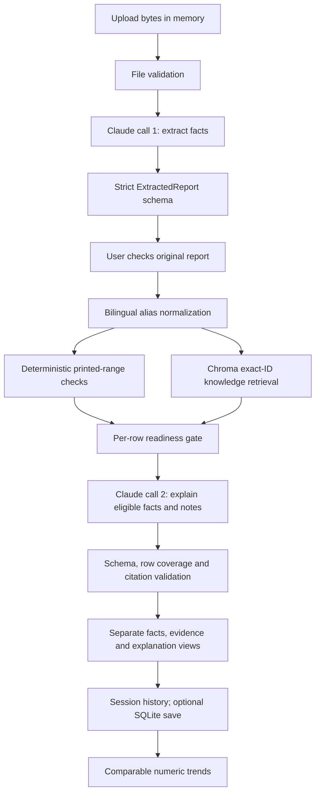

# Architecture and validation boundaries

The application remains a single Streamlit process. There is no web API service,
database server, background queue or container requirement.

## Contracts

`ExtractionPayload` is the model-facing schema; it cannot supply source verification or IDs.
`tracking.py` creates application-owned occurrence IDs and immutable source snapshots,
optionally matching unique complete lines in local PDF text (not scanned image OCR).
`ExtractedReport` contains those source links plus raw measurement strings, units, printed reference text,
printed flags and uncertainty. There are no patient identity fields. The model is
not permitted to invent reference intervals when extraction fails.

`CheckedIndicator` adds an application-generated row ID, canonical indicator ID,
deterministically parsed number and range status. Status is `within_range`, `high`,
`low`, `unknown` or `conflict`; there is no diagnosis or urgency field. Qualified
values (`<5`), qualitative values, absent units, ambiguous ranges and uncertain
extraction do not receive a definite range classification. A printed flag that
contradicts the calculation becomes `conflict`.

`Evidence` contains the full retrieved note, its actual project-relative source ID,
content hash and explicit provenance metadata (stable ID/version, sources, applicability,
review status and review details). All 26 shipped notes remain unverified and block live
explanation, regardless of whether their headers and hashes match. The copied content preserves the
evidence used at analysis time even if the local knowledge base changes later.

`InterpretationDecision` adds interpretable / needs_review / insufficient_evidence /
unsupported, with reason codes, messages and actions. `abstention.py` builds these
decisions from existing checks. Readiness is not medical risk or model confidence.

`GeneratedAnalysis` is requested only for eligible rows. Unknown/extra fields are forbidden.
Each eligible row must appear exactly once with its retrieved note ID. Missing, duplicated
or wrongly cited explanations are withheld per row. Unknown response rows are discarded.
Model-generated report summaries/limitations and arbitrary user questions are not forwarded
to bypass the gate. Summary counts and displayed limitations are deterministic application text.
This validates structure and routing, not truthfulness of natural-language prose.

`ReportRecord` stores the facts, checked rows and optional generated explanation as
separate fields, with immutable extraction and explicit before/after corrections.
Unconfirmed, stale or conflicting edits cannot unlock interpretation. Loading recomputes
the derived checks and readiness, verifies evidence
integrity and validates citation references again. A failed explanation call does
not discard extracted facts: the result displays a clear explanation-unavailable notice.

Schema v4 is current. V2/v3 records are upgraded in memory without automatically changing
their files. Old explanations are withheld because they did not pass the new gate.
Missing decisions are recomputed; genuinely corrupt records retain the skip/warning behavior.
Migrated source locations stay unknown; UUIDs identify retained row occurrences, not newly
verified evidence. Original snapshots must match extraction and checked row IDs must match
their source occurrences. User corrections never overwrite the original snapshots.

## Storage and trend boundaries

The live record ID is a random UUID, not a timestamp or filename. SQLite writes are
transactional and SQL values are parameterized. A series label groups observations
that the user confirms belong to the same person; no automatic patient matching is
attempted. Synthetic records are isolated from live history.

Trends require a canonical ID, a reviewed report, an unambiguous report date, a numeric
value and an allowed unit. Repeated indicators in one report, uncertain extraction and
conflicting flags are excluded. Missing indicators are absent, never filled with zero
or "normal". Compatible units are normalized; incompatible units remain separate.
Repeated dates are displayed as points rather than an invented within-day sequence.

## Compatibility with the prototype

The root `app.py` remains the launch entry point. The root `analyzer.py`, `rag.py` and
`history.py` are small re-exports of the new classes; they do **not** preserve the old
function signatures. Integrations using the old Python API need to migrate. No legacy
history or vector directory is automatically deleted or imported.

The old nearest-neighbor retrieval over a generic query and automatic urgency rating
have been removed. Exact entity retrieval is deliberate at this corpus size. Semantic
retrieval can be added later with an evaluated fallback and explicit confidence policy.
